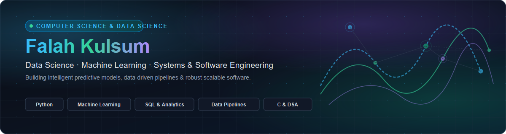

 

# Falah Kulsum

**Computer Science & Engineering Student** &middot; **Data Science Specialization**

Aspiring Data Scientist & Software Engineer &bull; Building strong foundations in Machine Learning, Algorithms & Scalable Systems

 

 

> *"Transforming data into insights, curiosity into code, and problems into intelligent solutions."*

---

## 👩‍💻 About Me & Academic Journey

I am an undergraduate student pursuing a **Bachelor of Engineering in Computer Science & Engineering with a specialization in Data Science (CS-DS)**.

I am passionate about discovering actionable patterns in complex data, designing predictive machine learning pipelines, and building robust, scalable software systems. My academic and practical focus centers on combining strong mathematical foundations—probability, statistics, linear algebra, and discrete structures—with modern software engineering best practices.

### 🎯 What I'm Focused On
- **Data Science & Exploratory Analytics:** Ingesting, cleaning, and preprocessing messy real-world datasets with Python (Pandas, NumPy, Matplotlib, Seaborn) to uncover underlying correlations and statistical distributions.
- **Machine Learning Fundamentals:** Training and benchmarking supervised and unsupervised learning algorithms (Linear/Logistic Regression, Decision Trees, Random Forests, SVMs, Clustering) using Scikit-Learn.
- **Data Structures & Algorithms (DSA):** Developing efficient, memory-conscious computational problem-solving abilities in C and Python, with a strong focus on algorithmic complexity ($O(n)$ time/space analysis).
- **Databases & Data Engineering:** Structuring relational database schemas, executing analytical SQL queries (PostgreSQL, SQLite), and understanding data transformation workflows.
- **Modern Developer Workflows:** Leveraging Git version control, GitHub collaboration, Linux/WSL environments, and containerized architectures for reproducible builds.

 

---

## 🛠️ Technical Toolkit & Learning Stack

### Programming Languages

### Data Science, Machine Learning & Analytics

### Web Development & Systems

### Developer Tools & Environments

 

---

## 🚀 Projects Roadmap & Academic Builds

A showcase of hands-on data science pipelines, analytical software, and algorithmic implementations built throughout my studies:

### 1. 📊 Exploratory Data Analysis & ML Predictive Pipeline *(In Progress)*
> **Tech:** `Python 3.12` &middot; `Pandas` &middot; `NumPy` &middot; `Scikit-Learn` &middot; `Seaborn` &middot; `Matplotlib`
- **Data Preprocessing & EDA:** Ingestion and cleaning of real-world multidimensional datasets, handling missing entries, encoding categorical variables, and detecting outliers.
- **Feature Engineering:** Calculating correlation matrices, variance inflation factors (VIF), and extracting predictive signals.
- **Model Benchmarking:** Training baseline classifiers (Random Forest, Gradient Boosting, Logistic Regression) with k-fold cross-validation and evaluating precision, recall, and ROC-AUC curves.

---

### 2. 🧩 Data Structures & Algorithmic Problem Solving Suite
> **Tech:** `C` &middot; `Python` &middot; `DSA` &middot; `Computational Complexity`
- **Core Structures:** Clean, modular implementations of linked lists, stacks, queues, binary search trees (BST), and hash tables.
- **Graph & Tree Algorithms:** Implementations of Breadth-First Search (BFS), Depth-First Search (DFS), Dijkstra's shortest path, and dynamic programming optimization patterns.
- **Testing & Benchmarks:** Rigorous edge-case testing with empirical runtime benchmarking against varying input sizes.

---

### 3. 🌐 Interactive Data Visualization & Intelligence Dashboard *(Planned)*
> **Tech:** `FastAPI` &middot; `Streamlit` &middot; `React` &middot; `Plotly` &middot; `PostgreSQL`
- **Interactive Analytics:** Web dashboard empowering users to interactively filter metrics, tune hyperparameters, and visualize model outputs in real time.
- **Model Serving:** Lightweight REST API endpoints serving fast model inferences for incoming batch queries.

---

### 4. ⚡ Full-Stack Web & Intelligence Application *(Planned)*
> **Tech:** `React` &middot; `Node.js` / `FastAPI` &middot; `PostgreSQL` &middot; `Tailwind CSS`
- **Architecture:** Responsive full-stack application connecting structured relational data with an intuitive user experience.
- **Security & Quality:** Secure session management, input validation, and clean asynchronous data fetching.

 

---

## 📈 GitHub Activity & Insights

  <picture>
    <source media="(prefers-color-scheme: dark)" srcset="https://raw.githubusercontent.com/falahkulsum12/falahkulsum12/output/github-snake-dark.svg" />
    <source media="(prefers-color-scheme: light)" srcset="https://raw.githubusercontent.com/falahkulsum12/falahkulsum12/output/github-snake.svg" />
    
  </picture>

 

  
  &nbsp;
  

 

---

## 🤝 Let's Connect!

I am always keen to connect with fellow students, developers, researchers, and mentors. Whether you want to discuss Data Science, Machine Learning, software projects, or explore collaboration opportunities:

&nbsp;&nbsp;

&nbsp;&nbsp;

 

---

## 📜 Copyright, Attribution & Academic Integrity

**Copyright (c) 2026 Falah Kulsum. All rights reserved.**

> ### 📌 Notice Regarding Academic Submissions & Plagiarism
> This repository and profile represent original coursework, research, and portfolio builds created by **Falah Kulsum**.
>
> - **Portfolio & Evaluation Use:** This profile and associated documentation are publicly available for technical review, peer exploration, and prospective career evaluation.
> - **Prohibition of Plagiarized Academic Submission:** Unauthorized duplication, reproduction, or submission of original project architectures, text, or implementations as academic coursework or institutional degree submissions is strictly prohibited.
> - **Third-Party Rights:** All third-party marks, badges, and open-source dependencies remain subject to their respective licenses and terms.

 

---

  Crafted with curiosity by <b>Falah Kulsum</b> &middot; CS (Data Science) Student &middot; Always Learning & Building

